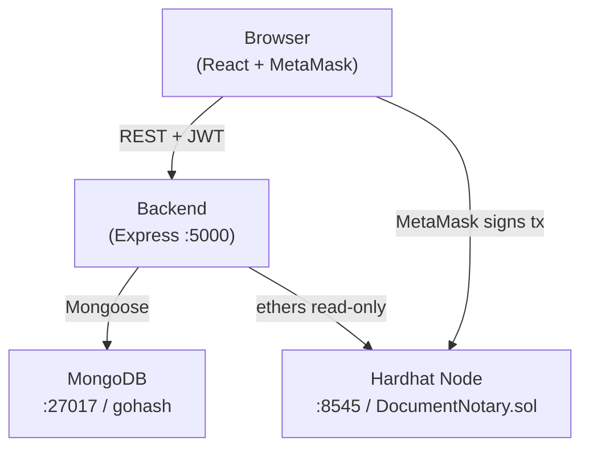
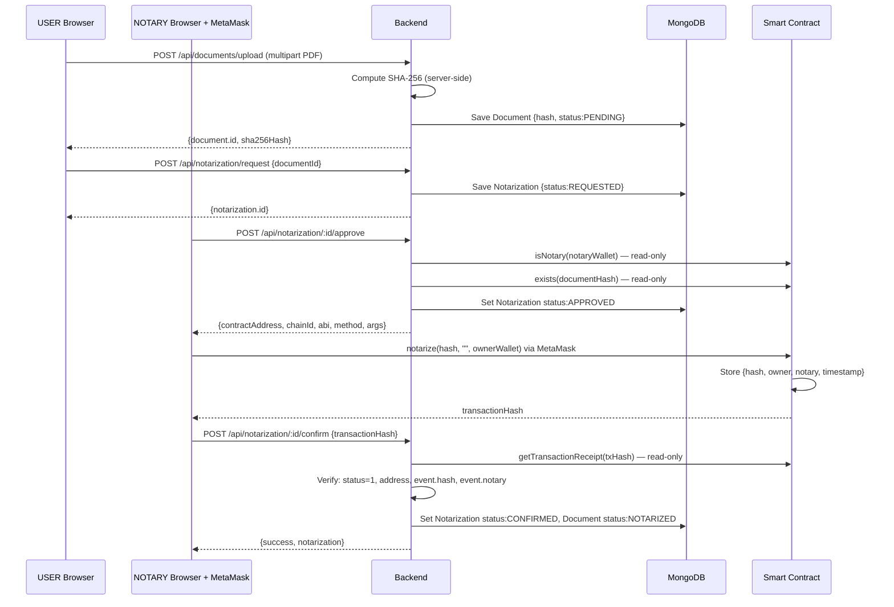
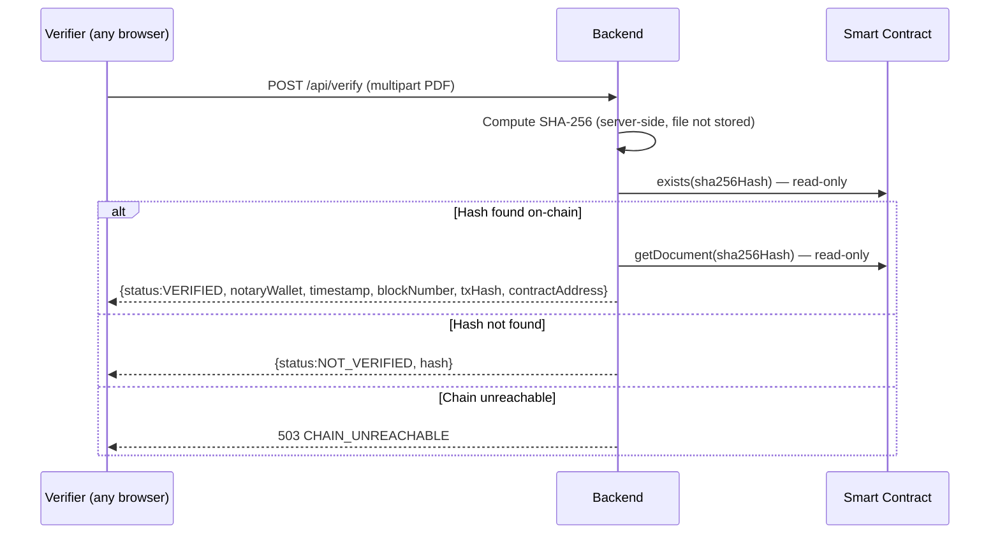

# GoHash — System Architecture

> Wording standard: on-chain timestamps mean **"the hash was recorded no later than this time"**. SHA-256 is a one-way cryptographic digest, not encryption. Never use "immutable", "unhackable", "tamper-proof", "court-admissible", or "legally valid".

---

## 1. Component Responsibilities

| Component | Technology | Responsibility |
|:----------|:-----------|:---------------|
| **Frontend** | React 18 + Vite 5 + Tailwind CSS 3 | User interface; JWT management; MetaMask integration; displays server-computed hashes |
| **Backend** | Express 4 + TypeScript + Mongoose 8 | REST API; SHA-256 computation; JWT issuance; receipt verification; PDF storage |
| **MongoDB** | Docker container `gohash-mongo` | Persistent storage for users, document metadata, notarization state |
| **DocumentNotary.sol** | Solidity 0.8.24 on Hardhat | Records SHA-256 hash, owner wallet, notary wallet, and block timestamp on-chain |
| **Hardhat Node** | Local JSON-RPC at port 8545 | Test blockchain (Chain ID 31337); deterministic accounts; erases on restart |
| **MetaMask** | Browser extension | Signs challenge messages (wallet link) and notarize transactions; holds private keys |

---

## 2. Trust Boundaries

```
╔══════════════════════════════════════════════════════════════════╗
║  UNTRUSTED — Browser                                            ║
║                                                                  ║
║  • React app never computes hashes; never holds private keys.    ║
║  • JWT stored in localStorage (accessible to JS).                ║
║  • MetaMask signs only; private key never leaves the extension.  ║
║  • Pending tx hash stored in sessionStorage for recovery only.   ║
╚═══════════════════════╤══════════════════════════════════════════╝
                        │  REST (HTTPS in production, HTTP locally)
╔═══════════════════════▼══════════════════════════════════════════╗
║  TRUSTED — Backend (Express)                                    ║
║                                                                  ║
║  • Decides all verification outcomes.                            ║
║  • SHA-256 always computed here (server-side only).              ║
║  • Read-only JSON-RPC provider; no private key, no signer.       ║
║  • Helmet, CORS (CORS_ORIGIN only), rate limiting, Zod input     ║
║    validation, JWT HS256 algorithm pinned, body limit 1 MB.     ║
║  • Receipt verification before NOTARIZED: tx.status=1,          ║
║    receipt.to == contractAddress, DocumentNotarized event,       ║
║    event.documentHash == expected, event.notary == notaryWallet. ║
╚═══════╤═══════════════════════════════════╤════════════════════ ═╝
        │ Mongoose                          │ ethers.js (read-only)
╔═══════▼═══════╗              ╔════════════▼═══════════════════════╗
║  MongoDB      ║              ║  Hardhat Local Node  :8545         ║
║  :27017       ║              ║  DocumentNotary.sol                ║
║  gohash       ║              ║  (proof layer; public on-chain)    ║
╚═══════════════╝              ╚════════════════════════════════════╝
```

---

## 3. System Overview Diagram



---

## 4. Notarization Sequence Diagram



---

## 5. Verification Sequence Diagram



---

## 6. What Is Stored Where

| Data item | MongoDB | Disk | On-chain | Browser |
|:----------|:-------:|:----:|:--------:|:-------:|
| User email, name, passwordHash | ✓ | | | |
| User wallet address | ✓ | | | |
| Document metadata, SHA-256 hash | ✓ | | | |
| PDF file content | | ✓ `uploads/<id>.pdf` | | |
| Notarization state (REQUESTED → CONFIRMED) | ✓ | | | |
| Transaction hash, block number, contract address | ✓ | | | |
| On-chain proof (hash, owner, notary, timestamp) | | | ✓ | |
| JWT session token | | | | localStorage |
| Pending tx hash (recovery) | | | | sessionStorage |

---

## 7. Backend Receipt Verification (POST /api/notarization/:id/confirm)

The backend performs these checks **in order** before setting status to NOTARIZED:

1. **`tx.status === 1`** — transaction did not revert (`TX_REVERTED` → sets FAILED).
2. **`receipt.to === contractAddress`** — transaction was sent to the correct contract (`WRONG_CONTRACT`).
3. **`tx.from === notary.walletAddress`** — transaction was signed by the registered notary wallet (`WRONG_SIGNER`).
4. **`DocumentNotarized` event present** — the notarize function ran successfully.
5. **`event.documentHash === expectedHash`** — the correct document hash was recorded (`WRONG_HASH`).
6. **Transaction hash not already used** — prevents replay attacks (`already used by another confirmed notarization`).

If the transaction is not yet mined, the backend returns HTTP 202 `TX_PENDING`; the frontend polls every 2 seconds for up to 30 seconds.

---

## 8. Smart Contract Architecture

One shared `DocumentNotary` contract; no per-user contracts and no NFTs or tokens.

- **`contractOwner`** (address set at deployment): can call `addNotary()` and `removeNotary()`.
- **Authorized notaries** (addresses added by owner): can call `notarize(bytes32 documentHash, string ipfsCid, address owner)`.
- **Anyone**: can call the view functions `exists()`, `getDocument()`, `verify()`, `isNotary()`, `getDocumentsByOwner()`.

**IPFS note:** The `ipfsCid` parameter exists in the contract but is always sent as `""` in this prototype. IPFS integration is future work.
